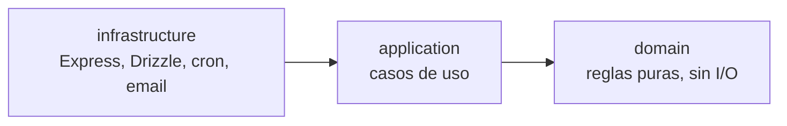
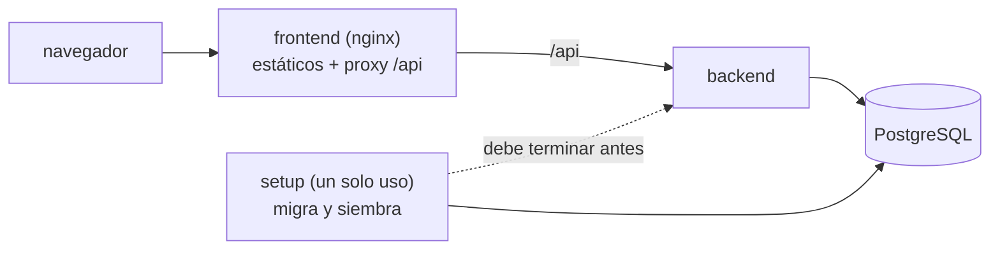

# Gestor de turnos

[](https://github.com/Francoreinoso/gestor-turnos-saas/actions/workflows/ci.yml)

## Qué es y qué problema resuelve

SaaS multi-negocio para profesionales independientes (peluquerías, consultorios, estudios) que atienden por turno. Reemplaza la agenda en papel y los mensajes cruzados por WhatsApp: el negocio publica sus horarios, el cliente reserva solo, sin crear cuenta, y el dueño ve la agenda, los pagos y cuánto le corresponde a cada profesional.

El problema técnico central es que **dos reservas no pueden pisarse nunca**, ni siquiera cuando llegan al mismo tiempo; por eso esa regla vive en la base de datos y no en el código de la aplicación.

## Funcionalidades

Con pantalla:

- **Reserva pública sin login**: el cliente elige servicio, profesional (o "Cualquiera"), día y horario, y recibe un enlace de gestión para ver, cancelar o reprogramar su turno.
- **Agenda del día**, solo lectura: el dueño ve todos los turnos del negocio y cada profesional los propios.

Solo por API (todavía sin pantalla; ver [Operar el negocio sin pantallas](#operar-el-negocio-sin-pantallas-por-ahora)):

- **Servicios**: alta, edición, cambio de precio con su historial y baja lógica.
- **Gestión de trabajadores**: invitación, activación, edición, baja y revocación de acceso.
- **Horario semanal** por profesional, del que se derivan los horarios libres.
- **Turnos desde el panel**: alta, edición, cancelación, bloqueos y corrección de asistencia.
- **Pagos y comisiones**: cada turno completado genera un pago con la comisión del profesional; resumen financiero por período.

## Stack

| Capa | Tecnología |
|---|---|
| Backend | Node 22 + Express 5, JavaScript con módulos ES |
| Base de datos | PostgreSQL 17 con Drizzle ORM (migraciones `.sql` revisadas a mano) |
| Autenticación | JWT para el panel; tokens de un solo turno, hasheados, para el cliente |
| Frontend | React 19 + Vite + React Router, en TypeScript |
| Pruebas | `node:test` (backend), Vitest + Testing Library (frontend) |
| Entorno | Docker Compose (db, setup, backend, frontend con nginx) y GitHub Actions |

## Arquitectura

El backend sigue clean architecture: las dependencias apuntan siempre hacia adentro.



Con Docker Compose el sistema completo son cuatro servicios:



## Inicio rápido

Requiere Docker con Compose v2 (en Windows, usar WSL).

```bash
git clone https://github.com/Francoreinoso/gestor-turnos-saas.git && cd gestor-turnos-saas
cp .env.example .env
docker compose up --build
```

La primera vez construye las imágenes, espera a la base, aplica las migraciones, siembra la cuenta demo y recién entonces arranca el backend.

| Qué | URL |
|---|---|
| Aplicación (login del panel) | http://localhost:5173 |
| Reserva pública de la cuenta demo | http://localhost:5173/reservar/00000000-0000-4000-8000-000000000001 |
| Salud del backend | http://localhost:3000/health |

Las variables de `.env` (todas con valores de desarrollo que funcionan tal cual):

| Variable | Para qué |
|---|---|
| `POSTGRES_DB`, `POSTGRES_USER`, `POSTGRES_PASSWORD` | Base de datos; `docker-compose.yml` arma `DATABASE_URL` a partir de ellas |
| `JWT_SECRET` | Firma de los JWT. **Cambiarla** fuera de desarrollo |
| `SEED_DEMO` | `true` siembra la cuenta demo si todavía no existe; `false` solo migra |
| `TZ` | Zona horaria de los contenedores (por defecto `America/Santiago`) |
| `DB_PORT`, `BACKEND_PORT`, `FRONTEND_PORT` | Puertos publicados, por si 5432, 3000 o 5173 están ocupados |

El backend sin Docker lee además `NODE_ENV`, `PORT`, `DATABASE_URL` y `TRUST_PROXY` desde `backend/.env` (ver `backend/.env.example`). `TRUST_PROXY` es la cantidad de proxies de confianza delante del backend: con `0` (por defecto) ignora `X-Forwarded-For`; Docker Compose lo fija en `1` porque nginx va delante.

**Zona horaria:** los horarios libres se calculan en la hora local del servidor, y el navegador los muestra en la suya. Conviene que ambos compartan zona; por eso `TZ` es configurable.

**Reiniciar y volver a empezar:** un nuevo `docker compose up` no recrea la demo si ya existe, así que no pierde lo que hayas probado. Para volver al estado inicial: `docker compose exec backend npm run db:seed` (recrea la cuenta con fechas de hoy) o `docker compose down -v` (borra la base). Si una migración falla, el backend no arranca y el motivo está en `docker compose logs setup`.

### Sin Docker (desarrollo)

Necesita un PostgreSQL con la extensión `btree_gist` (viene en el paquete `contrib`). Para tener solo la base en Docker: `docker compose up -d db`.

```bash
cd backend
cp .env.example .env
npm install
npm run db:migrate
npm run db:seed
npm run dev
```

En otra terminal:

```bash
cd frontend
npm install
npm run dev
```

El frontend queda en http://localhost:5173 y reenvía `/api` al backend en el puerto 3000, igual que nginx en Docker.

## Usuarios de ejemplo y roles

El seed crea el negocio **Peluquería Demo** con id fijo `00000000-0000-4000-8000-000000000001`, 2 profesionales con horarios y comisiones distintas, 3 servicios, 4 clientes, turnos completados con su pago, turnos agendados en los próximos días hábiles, un bloqueo y un turno cancelado.

| Rol | Email | Contraseña |
|---|---|---|
| Owner | `demo.owner@example.com` | `demo1234` |
| Staff (Lucía, comisión 40 %) | `demo.lucia@example.com` | `demo1234` |
| Staff (Martín, comisión 50 %) | `demo.martin@example.com` | `demo1234` |

> Credenciales **solo para desarrollo**. El seed se niega a ejecutarse con `NODE_ENV=production`.

El enlace de gestión de un turno agendado (con su token) lo imprime el seed al terminar; cambia en cada ejecución.

| Acción | Owner | Staff | Cliente anónimo | Disponible en |
|---|---|---|---|---|
| Ver turnos | Todos los del negocio | Solo los propios | Solo el suyo, con su enlace | Pantalla |
| Reservar, cancelar o reprogramar | — | — | Sí, con el enlace de gestión | Pantalla |
| Crear turnos desde el panel | Sí, para cualquier profesional | Sí, para sí mismo | — | Solo API |
| Bloquear horarios | Propios, de cualquiera o del negocio entero | Solo los propios | — | Solo API |
| Editar servicios y precios | Sí | No | — | Solo API |
| Gestionar trabajadores | Sí | No | — | Solo API |
| Editar el horario semanal | De cualquier trabajador | Solo el propio | — | Solo API |
| Resumen financiero y pagos | Todos | Los propios | — | Solo API |

Un recurso fuera de alcance responde 404 y no 403, para no confirmar que existe (detalle en el [diseño §3.10](docs/diseno-gestor-turnos.md)).

## API

REST con JSON. Las rutas del panel exigen `Authorization: Bearer <JWT>`; las públicas no.

| Grupo | Rutas |
|---|---|
| Autenticación | `POST /auth/register`, `POST /auth/login` |
| Turnos (panel) | `/appointments` — listar, detalle, crear, `/block`, `/:id/cancel`, `/:id/cancel-block`, `/:id/correct` |
| Servicios y clientes | `/services`, `/clients` |
| Trabajadores | `/staff` — alta por invitación, edición, baja, `/:id/availability` |
| Pagos | `/payments`, `/payments/summary` |
| Disponibilidad | `GET /availability/:business_id` |
| Públicas | `GET /public/accounts/:id`, `POST /public/bookings`, `/public/appointments/:id` (ver, cancelar, reprogramar con `?token=`) |
| Salud | `GET /health` |

La especificación completa está en el [documento de diseño §4](docs/diseno-gestor-turnos.md).

### Operar el negocio sin pantallas (por ahora)

El panel todavía no tiene pantallas para administrar servicios, trabajadores ni horarios: se hace con la API. Estos comandos funcionan contra la demo (con Docker la API queda en `http://localhost:3000`, solo accesible desde tu máquina) y usan [`jq`](https://jqlang.org) para leer el token; sin `jq`, copia el valor de `"token"` de la respuesta.

```bash
API=http://localhost:3000
JSON='Content-Type: application/json'

# 1. Entrar como owner
TOKEN=$(curl -s $API/auth/login -H "$JSON" \
  -d '{"email":"demo.owner@example.com","password":"demo1234"}' | jq -r .token)
AUTH="Authorization: Bearer $TOKEN"

# 2. Servicios: listar, crear, cambiar el precio (queda en el historial) y dar de baja
curl -s $API/services -H "$AUTH"
curl -s $API/services -H "$AUTH" -H "$JSON" -d '{"name":"Tintura","duration_minutes":90,"price":"25000"}'
curl -s -X PATCH $API/services/<id>/prices -H "$AUTH" -H "$JSON" -d '{"price":"27000"}'
curl -s -X PATCH $API/services/<id>/deactivate -H "$AUTH"

# 3. Trabajadores: listar e invitar
curl -s $API/staff -H "$AUTH"
curl -s $API/staff -H "$AUTH" -H "$JSON" -d '{"name":"Camila Rojas","email":"camila@example.com","commission_rate":0.4}'

# 4. Activar la cuenta de la persona invitada. Todavía no se envía el email: el token de la invitación
#    queda en el log del backend (`docker compose logs backend | grep "\[email\]"`; sin Docker, en su terminal).
curl -s $API/public/staff-invitations/activate -H "$JSON" -d '{"token":"<token de la invitación>","password":"camila-2026"}'

# 5. Su horario semanal (0 = domingo … 6 = sábado); reemplaza el horario completo
curl -s -X PUT $API/staff/<id>/availability -H "$AUTH" -H "$JSON" \
  -d '[{"day_of_week":1,"start_time":"09:00","end_time":"13:00"},{"day_of_week":3,"start_time":"14:00","end_time":"18:00"}]'

# 6. Resumen financiero del mes
curl -s "$API/payments/summary?period=este_mes" -H "$AUTH"
```

Las contraseñas deben tener entre 8 caracteres y 72 bytes. Cada ruta, con sus cuerpos y códigos de error, está en el [documento de diseño §4](docs/diseno-gestor-turnos.md).

## Decisiones técnicas

- **Sin solapamientos, garantizado por la base.** Un trigger y una restricción `EXCLUDE` impiden dos turnos simultáneos del mismo profesional aunque lleguen en paralelo; la aplicación solo traduce el error a 409. ([§3.3](docs/diseno-gestor-turnos.md))
- **Cliente sin login, con token hasheado.** El enlace de gestión lleva un token aleatorio de un solo turno; en la base se guarda su SHA-256, nunca el token. Vence 2 horas antes del turno. ([§3.9](docs/diseno-gestor-turnos.md))
- **Aislamiento por cuenta con 404 en vez de 403.** Un recurso de otro negocio o de otro profesional no se distingue de uno inexistente. ([§3.10](docs/diseno-gestor-turnos.md))
- **Baja lógica.** Los servicios se desactivan y los turnos se cancelan; no se borran, para conservar el historial y los pagos. ([§3.5](docs/diseno-gestor-turnos.md))
- **Transacciones.** Cambiar un precio con su historial, reprogramar o completar un turno con su pago ocurre todo o nada. ([§3.4](docs/diseno-gestor-turnos.md), [§3.6](docs/diseno-gestor-turnos.md))
- **Validación con Zod, en un solo lugar.** Cada endpoint declara su entrada con un esquema puro de `domain/schemas/`; el primer fallo se traduce al mismo `{ error: <código> }` de siempre y las reglas de negocio quedan fuera. ([§4](docs/diseno-gestor-turnos.md), [spec 007](docs/specs/007-validacion-zod/spec.md))
- **Clean architecture.** `domain` sin I/O, `application` orquesta y `infrastructure` es reemplazable; el seed usa los mismos casos de uso que la API, así los datos demo respetan las mismas reglas. ([§5](docs/diseno-gestor-turnos.md))

## Seguridad

Qué protege el sistema hoy ([spec 008](docs/specs/008-endurecimiento-api/spec.md)):

- **Errores que no filtran nada.** Un error inesperado responde siempre `{ "error": "internal_error" }`; el detalle (consulta SQL, traza) queda solo en el log del servidor, sin la query string —que puede llevar el token de un enlace de gestión—. Los errores del parser de JSON se traducen a un código fijo.
- **Identificadores validados antes de tocar la base.** Un id que no es UUID responde 404 como uno inexistente. Una prueba recorre las rutas registradas, de modo que una ruta nueva sin esa guarda hace fallar la suite.
- **Límite de intentos.** El login admite 10 intentos fallidos cada 15 minutos por IP (los correctos no cuentan), el registro 5 por hora, y las rutas públicas de escritura 20 cada 15 minutos. Detrás de nginx se cuenta por IP real del cliente (`TRUST_PROXY=1`).
- **Contraseñas.** De 8 caracteres a 72 bytes al crearlas (`bcrypt` trunca lo que pasa de 72). El login no revela si un email existe: hace siempre una comparación `bcrypt` completa, así que tarda lo mismo.
- **JWT con algoritmo fijo** (HS256): un token `alg: none` o de otro algoritmo se rechaza.
- **Configuración que falla rápido.** Sin `JWT_SECRET` el servidor no arranca; en producción además exige 32 caracteres como mínimo y rechaza los secretos de ejemplo del repositorio.
- **Cabeceras.** La API envía `nosniff`, `Referrer-Policy: no-referrer` y `Cache-Control: no-store`, y no `X-Powered-By`. El frontend, `nosniff`, `X-Frame-Options: DENY` y `no-referrer`, para que el token de un enlace de gestión no salga como `Referer`.
- **Backend solo en `127.0.0.1`** con Docker Compose: desde fuera de la máquina la API se alcanza únicamente a través del frontend, que es quien fija la IP real del cliente.

## Tests

```bash
cd backend
npm run db:migrate
npm test
```

Los tests de integración usan una base PostgreSQL real (`DATABASE_URL`). La suite debe pasar en cualquier zona horaria; la CI la corre con `TZ=UTC` y con `TZ=America/Santiago`.

```bash
cd frontend
npm test
npm run lint
npm run build
```

La CI ([`ci.yml`](.github/workflows/ci.yml)) ejecuta todo esto en cada push a `main` y en cada pull request, y además levanta `docker compose up --wait` y comprueba `/health`, la API pública a través del proxy y la página de reserva. Un test del backend verifica que este README no mienta: que los scripts, las variables de entorno y los enlaces que menciona existan.

## Metodología de trabajo

Cada feature sigue la misma cadena: [constitución](docs/constitution.md) → spec → plan → tasks, en una rama por spec y con TDD (primero el test que falla, priorizando los casos no obvios). Las especificaciones, los planes y las tareas de cada etapa están en [`docs/specs/`](docs/specs/); ante un conflicto, la constitución gana.

## Límites conocidos y roadmap

- Los horarios libres se calculan con la **hora local del servidor**: no hay zonas horarias por negocio. La zona por defecto es `America/Santiago`, que tiene horario de verano: las ventanas de atención son hora de pared y el cálculo de horarios libres tiene un test del fin de semana del cambio de hora, pero no hay pruebas de punta a punta de reservas que crucen ese cambio.
- **No se envían notificaciones** al cliente: el enlace de gestión se muestra en pantalla al reservar o reprogramar.
- El panel **solo muestra la agenda del día, en solo lectura**: crear o cancelar turnos, bloquear horarios, y administrar servicios, trabajadores, horarios y pagos existen únicamente como API.
- La **activación de un trabajador invitado no tiene pantalla** (solo endpoint).
- El owner no atiende turnos, pero la spec 001 todavía permite asignarle uno de forma explícita.
- La conexión a la base no ofrece una opción de SSL propia: se activa solo con `NODE_ENV=production`, y la base de Compose no lo soporta.
- **Faltan capturas de pantalla** en este README; se sumarán cuando la interfaz esté estable.
- El repositorio **no declara licencia** por el momento.
- **Sesiones:** el JWT dura 7 días y no hay refresh tokens ni cierre de sesión en el servidor; solo la baja de un trabajador revoca su acceso de inmediato.
- **Sin `Content-Security-Policy` ni `Strict-Transport-Security`:** la primera no puede verificarse sin un navegador real en la CI; la segunda corresponde al terminador TLS de un despliegue real, que este repositorio no incluye.
- Los **límites de uso viven en la memoria de cada proceso**: no se comparten entre varias réplicas del backend.
- Con Docker, la IP que ve nginx es la del cliente solo si Docker no la enmascara (por ejemplo, con Docker Desktop o redes rootless todos pueden aparecer con la IP de la puerta de enlace y compartir un mismo cupo).
- **Sin recuperación de contraseña** ni verificación de email.

Pendientes de producto: notificaciones por email o WhatsApp, zonas horarias por negocio, pantallas del panel para servicios, trabajadores y horarios, activación de trabajadores y recuperación de contraseña.

## Estructura del repositorio

```
.
├── backend/
│   ├── src/
│   │   ├── domain/            reglas puras
│   │   ├── application/       casos de uso
│   │   └── infrastructure/    http (Express), db (Drizzle), integraciones
│   ├── db/                    schema.js, migrate.js, seed.js y migraciones
│   ├── tests/                 domain, application, integration, docs
│   └── Dockerfile
├── frontend/
│   ├── src/                   domain, components, pages, services
│   ├── Dockerfile             build + nginx
│   └── nginx.conf
├── docs/
│   ├── constitution.md
│   ├── diseno-gestor-turnos.md
│   └── specs/                 una carpeta por spec
├── .github/workflows/ci.yml
├── docker-compose.yml
└── .env.example
```
